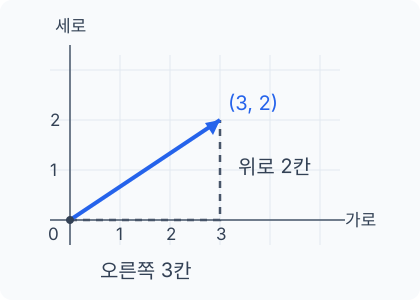

## 이동을 나타내는 두 숫자

격자 위의 한 점에서 오른쪽으로 3칸, 위로 2칸 이동하면 출발점과 도착점을 잇는 화살표를 그릴 수 있습니다. 이 화살표는 어느 방향으로 얼마나 이동했는지를 나타냅니다.

같은 이동을 숫자로 적으면 \((3,2)\)입니다. 가로 이동량을 먼저, 세로 이동량을 나중에 적습니다. 첫 번째 숫자 3은 오른쪽으로 3칸, 두 번째 숫자 2는 위로 2칸 움직였다는 뜻입니다.

이처럼 방향과 크기가 있는 이동량을 **벡터**로 나타냅니다. 이 벡터에 \(v\)라는 이름을 붙이면 \(v=(3,2)\)라고 쓰고, 벡터를 이루는 각각의 숫자를 **성분**이라고 합니다.

그림의 점선은 가로와 세로의 이동량을 나누어 보여 줍니다. 점선을 따라 움직이든 도착점까지 곧바로 움직이든 출발점과 도착점이 같으면 같은 벡터로 나타냅니다. 중간에 어떤 경로를 거쳤는지는 벡터에 담기지 않습니다.

## 성분의 부호와 순서

보통 좌표평면에서는 오른쪽과 위쪽을 양의 방향으로 정합니다. 반대 방향인 왼쪽과 아래쪽 이동은 음수로 적고, 한 방향으로 움직이지 않았다면 그 성분은 0입니다.

| 벡터 | 이동 |
| --- | --- |
| \((3,2)\) | 오른쪽으로 3칸, 위로 2칸 |
| \((-3,2)\) | 왼쪽으로 3칸, 위로 2칸 |
| \((3,-2)\) | 오른쪽으로 3칸, 아래로 2칸 |
| \((0,2)\) | 가로로는 움직이지 않고, 위로 2칸 |

성분을 적는 순서가 바뀌면 이동도 달라집니다. \((3,2)\)는 오른쪽 3칸, 위로 2칸이지만, \((2,3)\)은 오른쪽 2칸, 위로 3칸입니다.

아래 실험에서 가로 성분을 3에서 −3으로 바꿔 보세요. 화살표의 좌우 방향과 높이가 각각 어떻게 달라지는지 비교할 수 있습니다. **처음 상태로**를 눌러 값을 되돌린 뒤 **시작점 옮기기**를 누르면, 같은 이동을 다른 위치에서도 볼 수 있습니다.



## 출발점과 이동량

원점 \((0,0)\)에서 벡터 \((3,2)\)만큼 이동하면 \((3,2)\)에 도착합니다. 출발점을 \((-2,-1)\)로 옮기면 도착점도 달라집니다. 출발점의 가로 좌표에 3을, 세로 좌표에 2를 더하면 다음과 같습니다.

$$
(-2+3,\,-1+2)=(1,1).
$$

도착점은 \((1,1)\)이지만, 오른쪽으로 3칸, 위로 2칸 움직였다는 점은 같습니다. 두 화살표의 위치는 달라도 방향과 길이는 같으므로 같은 평면 벡터를 나타냅니다.

점의 좌표는 평면 위의 위치를, 벡터의 성분은 이동량을 나타냅니다. 점 \((3,2)\)와 벡터 \((3,2)\)를 같은 숫자로 적어도 뜻은 다릅니다. 원점에서 출발하면 도착점의 좌표와 벡터의 성분이 같아 둘을 혼동하기 쉽지만, 출발점을 옮겨 보면 차이를 확인할 수 있습니다.

## 이동량이 0인 벡터

가로·세로 성분이 모두 0이면 출발점에서 움직이지 않습니다. 이 벡터 \((0,0)\)을 **영벡터**라고 합니다. 출발점과 도착점이 겹치기 때문에 길이는 0입니다.

영벡터에는 정해진 방향이 없습니다. 오른쪽이나 위쪽 어느 쪽으로도 이동하지 않았기 때문입니다. 실험에서 두 성분을 모두 0으로 만들면 방향을 가진 화살표 대신 점이 표시됩니다.

## 확인 문제

**1. \((1,-2)\)에서 벡터 \((-2,3)\)만큼 움직이면 어디에 도착할까요?**


왼쪽으로 2칸, 위로 3칸 움직입니다. 도착점은 \((1-2,-2+3)=(-1,1)\)입니다. 도착점 \((-1,1)\)과 이동량 \((-2,3)\)은 서로 다릅니다.


**2. 두 화살표가 서로 다른 곳에 그려져 있어도 같은 벡터일 수 있을까요?**


가로·세로 이동량이 각각 같다면 같은 평면 벡터를 나타냅니다. 예를 들어 원점에서 \((3,2)\)까지의 화살표와 \((-2,-1)\)에서 \((1,1)\)까지의 화살표는 모두 오른쪽 3칸, 위로 2칸의 이동입니다.


오른쪽으로 3칸, 위로 2칸 이동한 뒤 다시 왼쪽으로 1칸 가면, 처음 위치에서 얼마나 이동한 셈일까요? 이렇게 두 이동을 이어 붙이는 계산이 [벡터의 덧셈](../vector-operations/)입니다.
